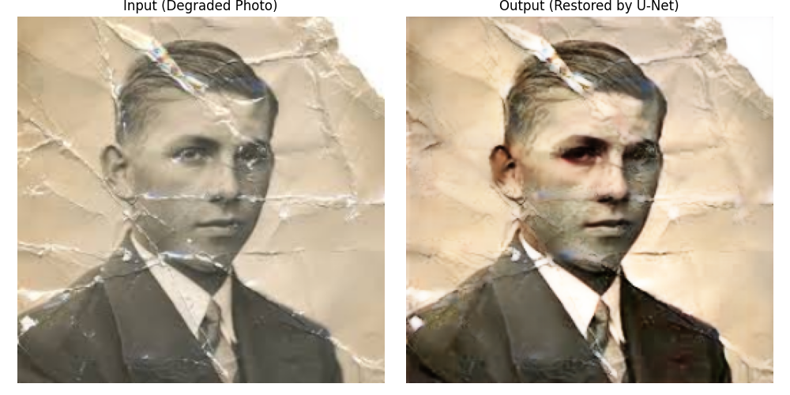
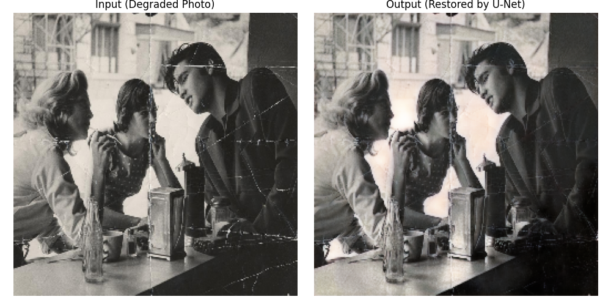
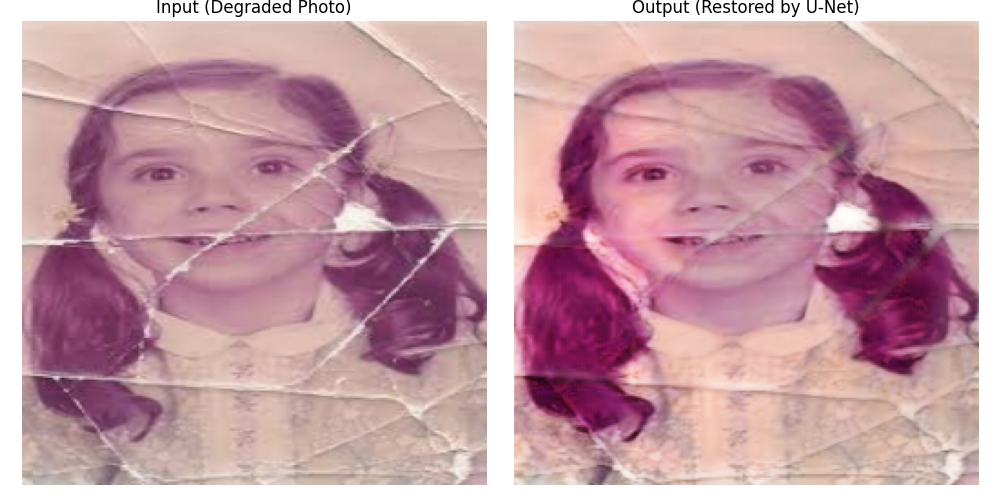
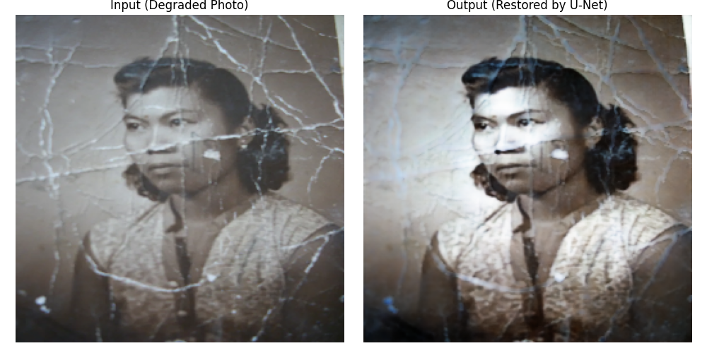

# 老照片修復 U-Net（final_demo_114b）

用 **U-Net** 學習把受損的老照片修復成清晰的照片。訓練資料是把 CelebA-HQ 人臉照片用程式「做舊」（泛黃、褪色、刮痕、模糊），組成「老照片 → 原圖」的配對資料集。

## 方法

1. **合成老照片**（`new_to_old.py`）：對乾淨照片隨機套用以下退化效果
   - 嚴重褪色（降低對比、提高亮度）
   - 泛黃（sepia 色調）
   - 物理損傷（隨機刮痕 + 低頻雜訊污漬）
   - 極度模糊（降解析度、高斯模糊、動態模糊）
2. **訓練 U-Net**（`train.py`）：4 層下採樣、4 層上採樣，搭配 skip connection；L1 Loss、Adam（lr = 1e-4）、混合精度（AMP）訓練，輸入 256×256。
3. **推論**（`inference.py`）：輸入一張老照片，並排顯示修復前後的結果。

## 檔案說明

| 檔案 | 說明 |
| --- | --- |
| `new_to_old.py` | `NewToOld` 類別：把乾淨圖片退化成老照片 |
| `dataset_test.py` | 批次處理 CelebA-HQ，產生 `celeba_hq_old` 老照片資料集 |
| `pair_dataset.py` | `PairedOfflineDataset`：讀取（老照片, 原圖）配對 |
| `u_net.py` | U-Net 模型定義（直接執行可檢查輸入與輸出維度） |
| `train.py` | 訓練腳本，每 5 個 epoch 存一次權重到 `weights/` |
| `inference.py` | 單張圖片修復並顯示結果 |
| `result/` | 修復結果範例圖 |

## 環境需求

```bash
pip install torch torchvision opencv-python numpy scipy matplotlib tqdm
```

訓練需要 NVIDIA GPU（使用 CUDA 混合精度）。

## 資料與模型（未包含在 repo 中）

- **CelebA-HQ**：放在 `celeba_hq/train/{female,male}/`。
- **老照片資料集**：執行 `dataset_test.py` 產生到 `celeba_hq_old/train/{female,male}/`。
- **模型權重**：執行 `train.py` 後會產生在 `weights/unet_epoch_*.pth`。

## 使用方式

> 程式中的路徑是寫死的絕對路徑，執行前請先改成自己電腦上的路徑。

```bash
python dataset_test.py   # 1. 產生老照片資料集
python train.py          # 2. 訓練 U-Net
python inference.py      # 3. 修復單張照片（修改 TEST_IMAGE_PATH、WEIGHT_PATH）
```

## 結果

| | |
| --- | --- |
|  |  |
|  |  |
